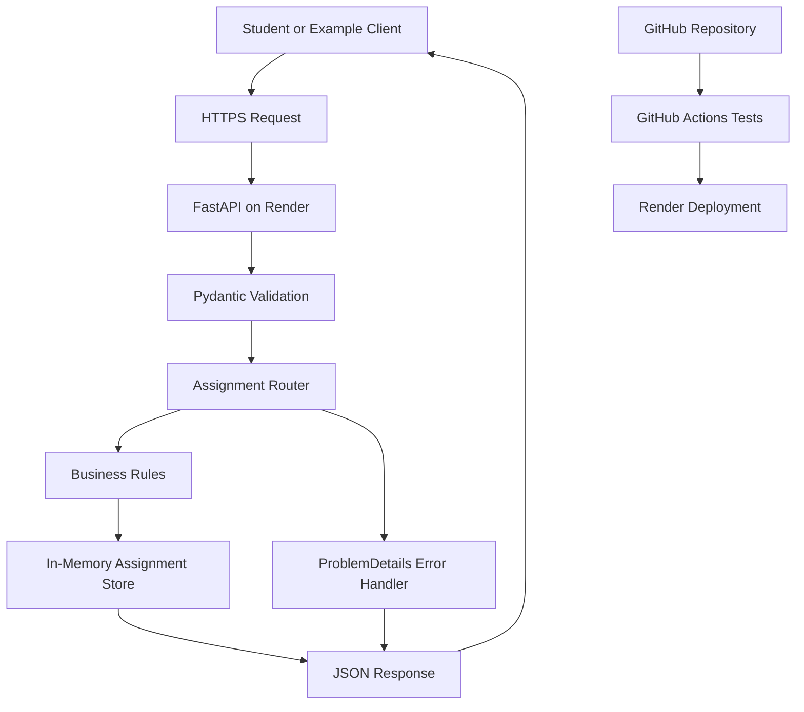

# Milestone 1 Proposal — Student Assignment Tracker

## 1. The Pitch

The Student Assignment Tracker is a small web API designed to help students manage assignments and deadlines across different courses. Students often have coursework spread across multiple classes, making it easy to lose track of what needs to be completed. This service provides one consistent place to create, view, update, and remove assignments.

The project focuses on a reliable API rather than building a full student portal. The goal is to demonstrate a service that follows a documented contract, handles errors clearly, and can be extended later.

## 2. Scope

For Milestone 2, the goal is to have a working, deployed FastAPI service that supports all seven operations defined in the OpenAPI specification.

Students and courses will be read-only resources. Assignments will support creating, listing, filtering by student, retrieving by ID, updating, and deleting.

The API will enforce a rule that completed assignments cannot have their deadlines changed until they are reopened in a separate request. All application errors will use the ProblemDetails format.

Stretch goals include persistent database storage, authentication, an improved user interface, and stronger protections against simultaneous updates. These are not required for the initial version.

## 3. Users

The primary user is a student managing assignments across several courses. A student should be able to see their assignments, identify deadlines, and mark completed work.

A secondary user is a developer building a web or mobile interface that communicates with the API. This developer needs consistent response formats, meaningful status codes, and clear error messages.

The API does not currently integrate with D2L or another learning management system. Students or client applications provide assignment information directly.

## 4. Failure That Matters

The most important failure is an assignment being changed incorrectly after the student has marked it completed.

For example, a student might accidentally change the deadline of a completed assignment and later become confused about when the work was originally due.

To reduce this risk, the API blocks deadline changes on completed assignments with a 409 Conflict response. A client must first reopen the assignment by setting its status to pending, then submit a separate request to change the deadline.

Other important failures include associating an assignment with a nonexistent course, accepting an invalid deadline, or returning an unclear error response.

## 5. Resources and Operations

The API includes three resources:

- Students: GET /v1/students
- Courses: GET /v1/courses
- Assignments: GET /v1/assignments, POST /v1/assignments, GET /v1/assignments/{assignment_id}, PATCH /v1/assignments/{assignment_id}, and DELETE /v1/assignments/{assignment_id}

Students and courses provide known identifiers for assignment creation. Assignment records include an ID, student ID, course ID, title, due date, completion status, and last-updated timestamp.

The OpenAPI 3.1 specification defines request bodies, responses, validation errors, and versioning.

## 6. Architecture Sketch

The client communicates with the FastAPI service through HTTPS. Pydantic validates incoming data, routers implement the API operations, and business rules enforce restrictions.

Assignments are held in memory, so a service restart loses newly created assignments. This is an intentional limitation of the initial implementation.

The main failure points are invalid client requests, conflicting updates, and temporary service unavailability. GitHub Actions runs automated tests before deployment changes are accepted.

## 7. What Changed Since the Pitch

- The initial idea was narrowed to three resources and seven API operations to keep the project manageable.
- The completed-assignment deadline restriction became an explicit business rule with a 409 Conflict response.
- The API specification was written before implementation and checked using Spectral and a Prism mock server.
- The actual FastAPI implementation now has unit tests and Schemathesis contract tests.
- Contract testing revealed that numeric timestamps were accepted incorrectly and malformed request bodies could produce undocumented responses. Both behaviors were corrected.

These changes reflect design decisions and implementation/testing work. No additional instructor feedback is assumed here.

## 8. Plan and Risks

**Milestone 2 — November 22, 2026:** Verify that the complete API remains deployed and accessible, review error messages and generated documentation, and improve automated testing where needed.

**Final submission — December 4, 2026:** Complete the final review, verify the documented API and example client, and prepare the final project documentation and demonstration.

The first risk is data loss because assignments are stored in memory. For this version, the limitation will be documented and tests will reset the store to produce predictable results.

The second risk is simultaneous requests updating the same assignment. The current implementation does not include locking or transactions. If persistent storage is added, concurrency protection will need to be addressed.

The third risk is that a deployed service may behave differently from local tests. To reduce this risk, GitHub Actions runs the test suite, and the example client will be exercised against the deployed Render service.
